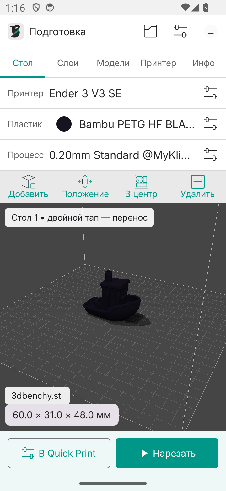
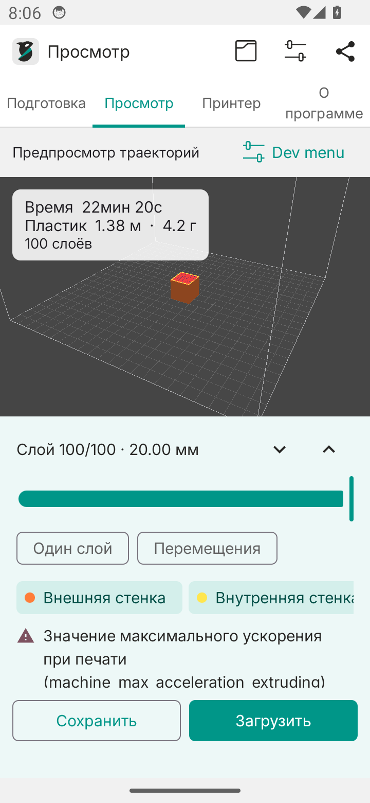
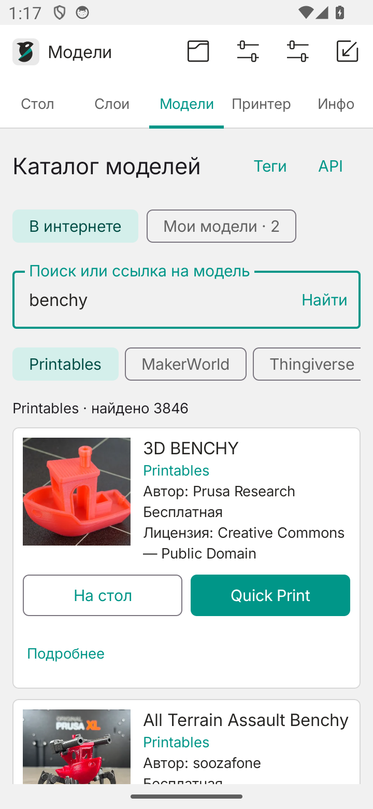
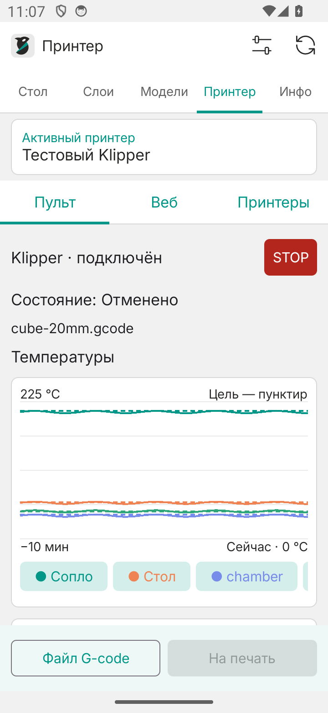
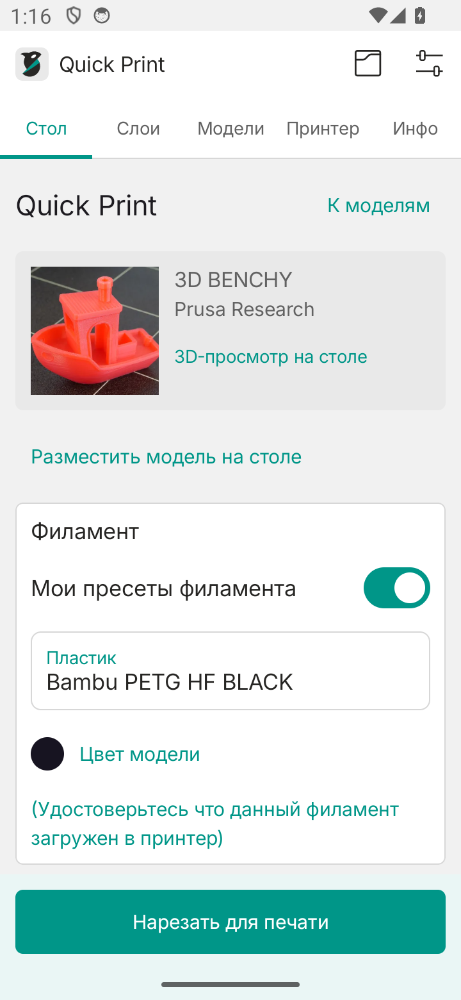
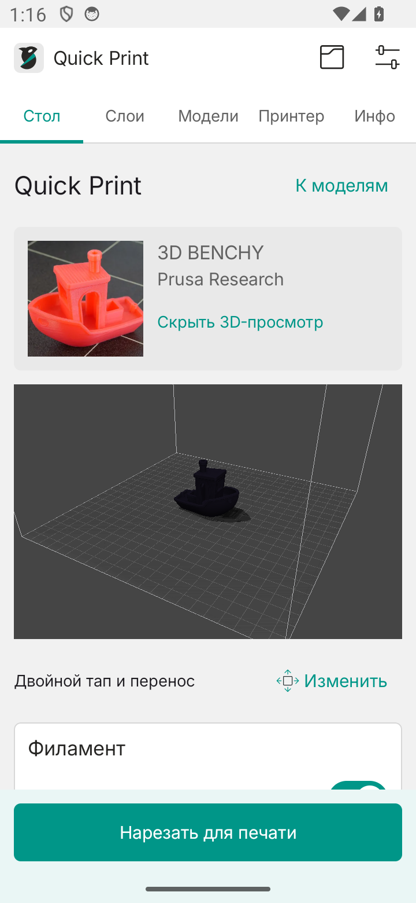

[Русский](README.md) · [English](README.en.md)

<p align="center">
  
</p>

# OrcaSlicer for Android

Prepare models, slice locally on your phone, inspect toolpaths and send G-code to a Klipper printer. The touch interface follows the colors and controls of desktop OrcaSlicer.

**Unofficial Android adaptation based on OrcaMicro and OrcaSlicer 2.4.2. Beta software.**

**Android 14+ · ARM64 · OpenGL ES 3**

[Download APK](https://github.com/redfaced97/OrcaSlicer-Android/releases/latest) · [User guide (RU)](docs/USAGE.md) · [Import profiles (RU)](docs/PROFILES.md) · [Build instructions (RU)](docs/BUILDING.md)

## New in 0.6.5

- Russian and English UI, selected from Android's locale or overridden in settings.
- Print start, elapsed active time, time including pauses and approximate finish time.
- Temperature windows of 1 / 5 / 10 minutes and polling every 1 / 5 / 10 / 30 seconds.
- OctoPrint connections, controls, telemetry, file upload and printing alongside Moonraker.
- Animated statistics for one printer or all saved servers; offline errors are listed separately.
- Read detected printer settings, review them and save a new local OrcaSlicer preset.
- **Upload | ∧**: send to printer or save G-code locally. The centered send panel has a model preview and separate **Upload** and **Print** buttons.
- Extended 3MF support: package root relationships, components and optional OrcaSlicer / Bambu Studio project settings.

[Detailed guide, data sources and limitations (RU)](docs/PRINTERS.md). OctoPrint statistics use counters of retained files; unknown total durations are shown as `—`.

## Screenshots

<p align="center">
  
  
</p>
<p align="center">
  
  
</p>
<p align="center">
  
  
</p>

## Features

- **Native model catalog:** JSON API clients for Printables, MakerWorld, Thingiverse and Cults3D. Photos appear on the left; title, author, source, price availability and license appear on the right. Search by text, tags or model URL, with pagination.
- **Quick Print:** model card → printer, filament and process → interactive plate → local slicing → G-code upload. Layout inspired by Bambu Handy.
- **Model cache:** files expire 7 days after their last opening by default. Choose 1, 3, 7, 14 or 30 days, disable expiry, or clear files manually. Saved cards and the current plate model remain available.
- **Placement:** move, rotate, scale, center and check whether the model fits the build volume.
- **OrcaSlicer profiles:** imported printers, filaments and processes are separated from bundled presets. Import individual JSON files or profile bundles and save edited presets.
- **Settings:** 638 parameters with English and Russian labels and help, search, categories, favorites and modified-value filtering.
- **Filament color:** palette and HEX input, including colors from imported profiles.
- **Local slicing:** OrcaSlicer through JNI, normal and tree supports, G-code export and Android sharing.
- **Toolpath preview:** layer selection, travel visibility and line-type filters. The visible **Dev menu** offers camera views, SSAO, shadows, plate surfaces and render-resolution controls.
- **Klipper / Moonraker:** multiple saved connections, discovered heaters and sensors, 10-minute temperature charts, XYZ movement, homing, fan controls and print pause/resume/cancel. Mainsail/Fluidd can also be opened inside the app. Uploading G-code and starting a print are separate actions.
- **Protected STOP:** emergency stop requires entering exactly `Stop Klipper!` and pressing the confirmation button. Closing the dialog or changing the selected printer does not send an emergency-stop command.
- **In-app updates:** new-release notifications, changelogs, background APK downloads, checksum and signature checks, and handoff to Android's installer.
- **Appearance:** light/dark themes, Inter with Cyrillic support and system font scaling.

Slicing works offline. Network access is needed for online catalogs, updates and printer connections.

## Installation and updates

1. Open [Releases](https://github.com/redfaced97/OrcaSlicer-Android/releases/latest).
2. Download `OrcaSlicer-arm64-vVERSION.apk` from **Assets** and install it on an ARM64 phone running Android 14 or newer.
3. `SHA256SUMS` is published alongside the APK. Release APKs keep the same signing certificate, so updates retain app data.

Starting with **0.6.2**, open **About / О программе → App updates / Обновления приложения** to check for a new release, read its changelog and download it. Android downloads the APK in the background. After verification, the app opens Android's installer. Allow installation from OrcaSlicer when Android asks, then confirm the installation. Silent installation is not used.

Automatic checks run at startup at most once every six hours and approximately once a day in the background; Android may postpone them. Enable Android notifications to receive alerts while the app is closed. Automatic checks can be disabled in About. Updating from 0.6.0 to 0.6.2 requires installing the release APK once; later updates can use the built-in updater. [Update details (RU)](docs/UPDATES.md).

Intermediate [GitHub Actions builds](https://github.com/redfaced97/OrcaSlicer-Android/actions/workflows/build.yml) may have a different signature. Export your profiles before switching APK sources. [Signing and builds (RU)](docs/BUILDING.md).

## First print

1. Select a bundled printer or import your own OrcaSlicer JSON configuration.
2. Choose your process and filament. Imported presets are listed under **Мои профили**.
3. Use **Подготовка → Добавить** to open an STL, 3MF or model ZIP. Check placement, dimensions and settings.
4. Press **Нарезать** and inspect the layers under **Просмотр**.
5. Alternatively, use **Quick Print** on a catalog card or **К печати** on the plate. Choose your printer and profiles, then adjust layer height, infill and walls. Press **Нарезать для печати**, followed by **Отправить на печать**.
6. Confirm that the selected filament is loaded and the plate is clear. **Upload / Загрузить** stores the file without starting. **Print / Напечатать** uploads and starts printing after confirmation.

The filament reminder reads: **“Make sure this filament is loaded in the printer.”** The interface displays the selected language.

Changing the model, print settings or selected printer invalidates the previous slice. The printer controller's **STOP** button opens a text confirmation: enter `Stop Klipper!` exactly. This sends an emergency shutdown; Klipper requires `FIRMWARE_RESTART` before normal operation can resume. Use Pause or Cancel for ordinary print-job control.

## Touch gestures

| Gesture | Action |
| --- | --- |
| One-finger drag | Orbit the camera |
| Two-finger drag | Pan the camera |
| Pinch | Zoom |
| Double-tap the model, hold the second touch and drag | Move the model on the plate without zooming |

Use **Положение** (or **Правка** on narrow screens) for exact coordinates, rotation and scale. Quick Print has an expandable 3D preview and a button to open the full plate, then return to preparation.

## Import desktop presets

Import individual JSON files, or prepare a bundle on your computer:

```sh
python3 scripts/export-desktop-presets.py \
  --resources /path/to/OrcaSlicer/resources
```

Copy `dist/private-presets/user-presets.json` to the phone. Open the printer, process or filament profile selector, press **Импортировать** and choose the file. The helper reads local user profiles, resolves inheritance and excludes passwords/API keys. [Profile guide and examples (RU)](docs/PROFILES.md).

## Catalog access and limitations

Printables and MakerWorld search work without a key. Thingiverse requires your App Token; Cults requires your nickname and API key. Some downloads require a personal Printables session cookie or Bambu access token. Configure these under **Модели → API**. Credentials are encrypted with Android Keystore and kept outside exported profiles and Android backup.

Cults API provides metadata but does not provide model files. Attach an STL, ZIP or 3MF you already obtained from the creator or purchased. If an API does not report a price, the card explicitly says so. Price and license are shown separately. Site APIs and access requirements may change. [Catalog, links and cache guide (RU)](docs/MODELS.md).

The app currently handles **one model, one plate and one material**. 3MF objects are combined into one model. Recognized OrcaSlicer / Bambu Studio project settings can be reviewed and applied separately; start/end G-code is retained from your preset and the first material is used. Painting, AMS assignments and multi-plate layout are not imported. STEP/OBJ, multi-material slicing, support/seam painting, modifiers and painted variable layer height are not implemented.

An exposed setting does not add a missing workflow. Matching every desktop OrcaSlicer G-code output or “90% compatibility” has not been demonstrated. [Compatibility details (RU)](docs/COMPATIBILITY.md).

## Development

Build requirements: JDK 17, Android SDK 35 and the ARM64 OrcaSlicer engine. The repository includes engine-fetch/build scripts, JVM tests and Android tests for real slicing, gestures and workflows. The updater uses GitHub Releases directly; no update server or GitHub password is required.

[Build and test instructions (RU)](docs/BUILDING.md)

## Team

| Role | Contributor |
| --- | --- |
| Producer | redfaced97 |
| Programmer | Codex GPT-6.1-Sol |
| Beta tester | redfaced97 and Ender 3 v3 SE (Klipper) |

## Sources and license

Android foundation and JNI bridge: [OrcaMicro](https://github.com/whoxllm/OrcaMicro), whoxllm and contributors. Engine, profiles, base translations and icons: [OrcaSlicer](https://github.com/OrcaSlicer/OrcaSlicer), SoftFever and contributors, based on Bambu Studio, PrusaSlicer and Slic3r. Missing Russian labels and explanations were added in this adaptation.

Project license: **[AGPL-3.0](LICENSE)**. Inter uses [SIL OFL 1.1](third_party/Inter-OFL.txt). Third-party notices and artwork sources are listed in [NOTICE](third_party/NOTICE.txt).
