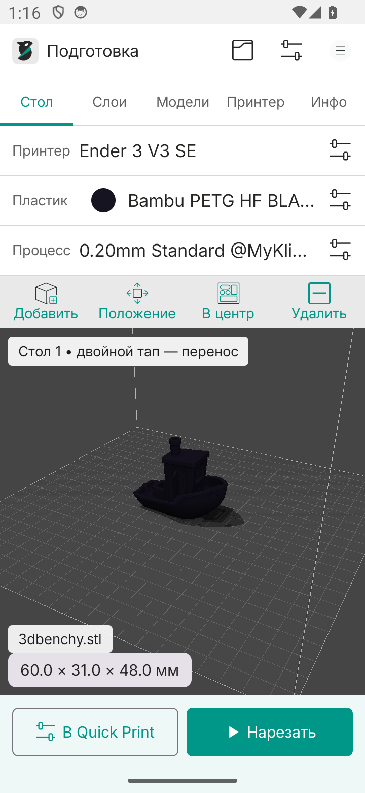
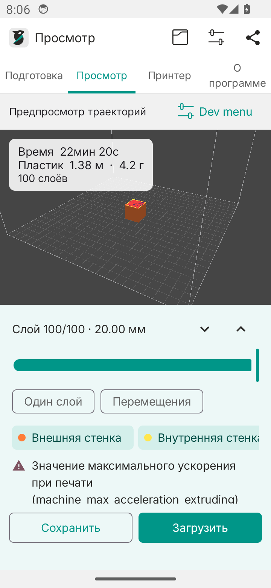
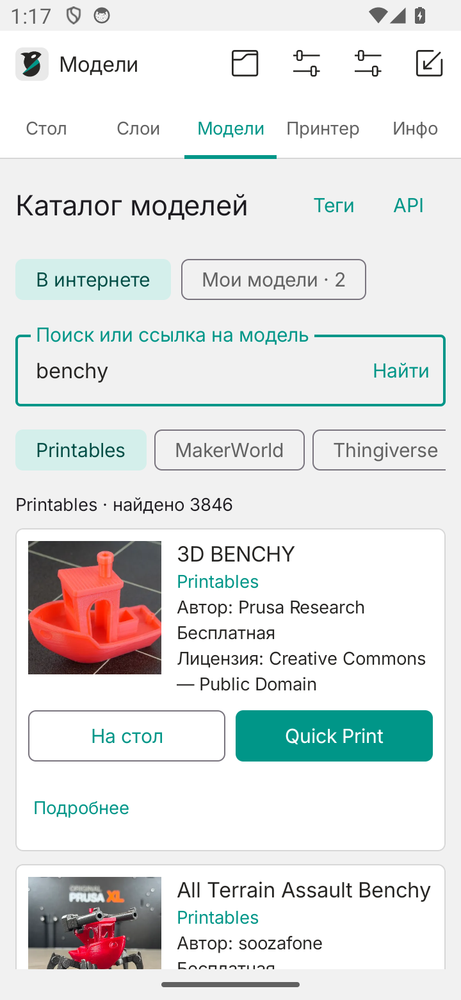
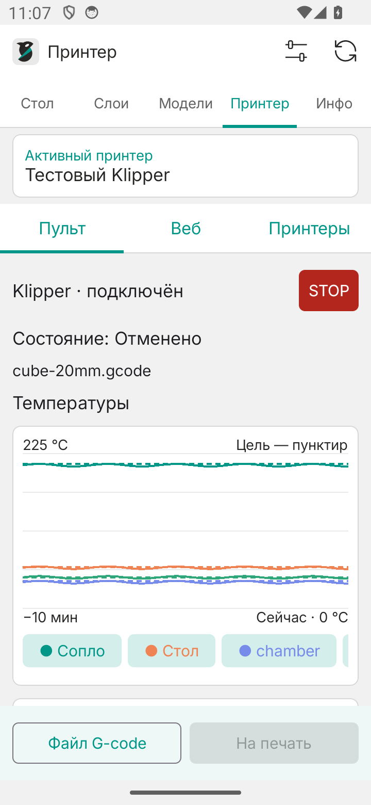
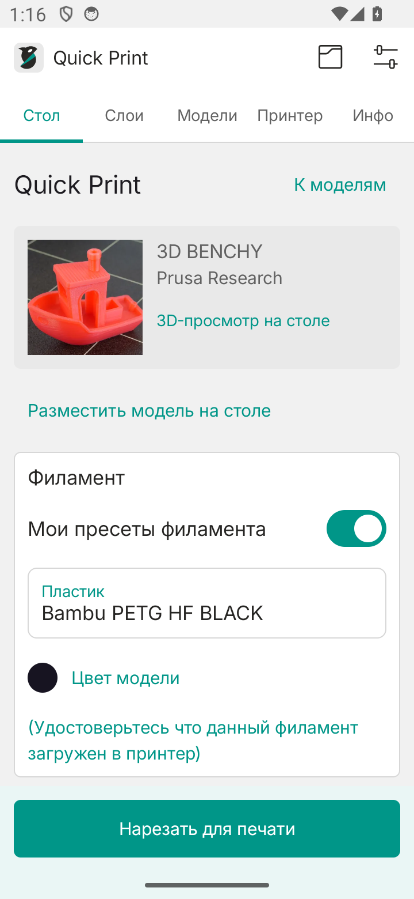
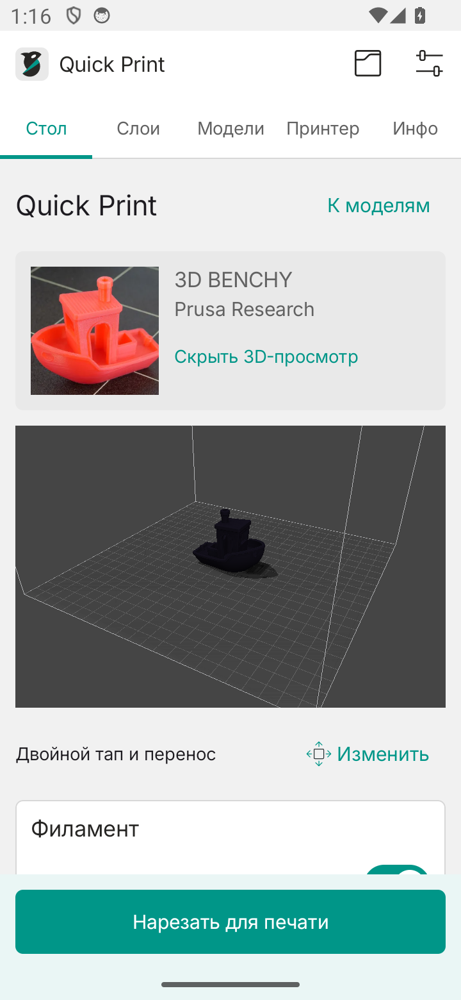

[Русский](README.md) · [English](README.en.md)

<p align="center">
  
</p>

# OrcaSlicer для Android

Слайсер для телефона: подготовка STL, нарезка прямо на устройстве, просмотр слоёв и загрузка G-code на Klipper. Интерфейс адаптирован для сенсорного экрана и использует оформление настольной OrcaSlicer.

**Неофициальная Android-адаптация на основе OrcaMicro и OrcaSlicer 2.4.2.** Проект находится в стадии бета-тестирования.

**Android 14+ · ARM64 · OpenGL ES 3**

[Скачать APK из Releases](https://github.com/redfaced97/OrcaSlicer-Android/releases/latest) · [Инструкция](docs/USAGE.md) · [Импорт профилей](docs/PROFILES.md) · [Сборка из исходников](docs/BUILDING.md)

## Как выглядит

<p align="center">
  
  
</p>

<p align="center">
  
  
</p>

<p align="center">
  
  
</p>

## Возможности

- **Нативный каталог моделей:** JSON API Printables, MakerWorld, Thingiverse и Cults3D; фото слева, название, автор, источник, цена и лицензия справа. Поиск по запросу, тегам и ссылке. Для Thingiverse/Cults нужен свой API-ключ. [Как пользоваться](docs/MODELS.md).
- **Quick Print:** карточка → свой принтер, пластик и процесс → редактируемый 3D-стол → нарезка → отправка G-code. Компоновка по образцу Bambu Handy.
- **Кэш:** 7 дней после последнего открытия, настраиваемый срок и ручная очистка; карточки сохраняются после удаления файлов.
- **Подготовка модели:** перемещение на столе, поворот, масштаб, центрирование и проверка габаритов.
- **Профили OrcaSlicer:** свои принтеры, процессы и пластики отдельно от штатных; импорт JSON и наборов профилей; сохранение собственных пресетов.
- **Параметры печати:** 638 настроек с русскими подписями и подсказками, поиск, разделы, избранное и фильтр изменённых значений.
- **Цвет пластика:** выбор цвета из палитры или по HEX, отображение цвета импортированного профиля.
- **Нарезка на телефоне:** движок OrcaSlicer через JNI, обычные и древовидные поддержки, экспорт и отправка G-code через «Поделиться».
- **Просмотр слоёв:** выбор слоя, фильтры типов линий и холостых перемещений. В открытом **Dev menu** доступны виды камеры, SSAO, тени, поверхности стола и разрешение сцены.
- **Защита STOP:** для экстренной остановки требуется точный ввод `Stop Klipper!`. Закрытие диалога или смена принтера не отправляют команду.
- **Обновления:** уведомление о новой версии, список изменений, фоновая загрузка APK, проверка SHA-256 и подписи, переход в системный установщик Android. [Как обновляться](docs/UPDATES.md).
- **Klipper / Moonraker:** несколько подключений, температуры всех обнаруженных нагревателей, графики за 10 минут, перемещение XYZ, Home, обдув, пауза/продолжение/отмена и аварийный STOP. Загрузка G-code и запуск печати — отдельные действия. Mainsail/Fluidd также доступен внутри приложения.
- **Оформление:** светлая и тёмная темы, шрифт Inter с кириллицей, поддержка системного масштаба текста.

Нарезка работает без интернета. Сеть нужна для каталогов моделей и подключения к принтеру.

## Установка

1. Откройте [Releases](https://github.com/redfaced97/OrcaSlicer-Android/releases/latest).
2. В **Assets** скачайте `OrcaSlicer-arm64-vVERSION.apk` и установите на телефон Android 14+ с ARM64.
3. Для проверки файла рядом опубликован `SHA256SUMS`. Обновление устанавливается поверх предыдущего APK из Releases и локальных сборок этого проекта.

В Releases публикуется проверенный APK с постоянной подписью. Промежуточные сборки доступны в [GitHub Actions](https://github.com/redfaced97/OrcaSlicer-Android/actions/workflows/build.yml); они могут иметь другую подпись. Перед сменой источника APK экспортируйте свои профили. [Подпись и обновления](docs/BUILDING.md#подпись-и-обновления).

## Обновление из приложения

Начиная с **0.6.2** откройте **«О программе» → «Обновления приложения»**. Здесь можно проверить релиз, прочитать изменения и нажать **«Скачать апдейт»**. После проверки файла приложение откроет установщик Android. При первом обновлении разрешите установку из OrcaSlicer, затем подтвердите установку. Профили сохраняются.

Автопроверка выполняется при запуске не чаще раза в 6 часов и примерно раз в сутки в фоне. Разрешите уведомления Android, чтобы получать сообщения о новых версиях при закрытом приложении. Автопроверку можно отключить. Переход с 0.6.0 на 0.6.2 выполняется установкой APK из Releases; следующие обновления доступны внутри приложения.

## Первый запуск

1. Выберите принтер из штатного каталога или импортируйте свой JSON из OrcaSlicer.
2. Выберите профиль процесса и пластика. Свои пресеты находятся в разделе **«Мои профили»**.
3. На вкладке **«Подготовка»** нажмите **«Добавить»** и откройте STL, 3MF или ZIP с моделями. Проверьте положение модели и параметры.
4. Нажмите **«Нарезать»**, затем изучите слои во вкладке **«Просмотр»**.
5. Через **«К печати»** выберите принтер, свой пластик и процесс, при необходимости измените высоту слоя, заполнение и стенки. В Quick Print нажмите **«Нарезать для печати»**, затем **«Отправить на печать»**, подтвердите наличие филамента и загрузите G-code. Для запуска нажмите **«Начать печать»**.

Модели с сайтов доступны на вкладке **«Модели»**. Вставьте ссылку прямо в поиск или выберите площадку. Кнопки **«На стол»** и **Quick Print** находятся в нативной карточке; файл скачивается через API при выборе.

Цветовой кружок в строке пластика открывает палитру. Изменённые параметры можно сохранить отдельным профилем через **«Сохранить как»** в библиотеке.

### Жесты в 3D-окне

| Жест | Действие |
| --- | --- |
| Свайп одним пальцем | Вращение камеры |
| Движение двумя пальцами | Перемещение камеры |
| Щипок двумя пальцами | Приближение и отдаление |
| Двойной тап по модели, удержать второй тап и потянуть | Перемещение модели по столу без изменения камеры |

Для точных координат, поворота и масштаба используйте **«Положение»**; на узком экране кнопка называется **«Правка»**.

## Перенос настроек с ПК

Можно импортировать отдельные JSON-профили или подготовить один набор скриптом:

```sh
python3 scripts/export-desktop-presets.py \
  --resources /path/to/OrcaSlicer/resources
```

Скопируйте полученный `dist/private-presets/user-presets.json` на телефон. Нажмите на строку **«Принтер»**, **«Процесс»** или **«Пластик»** → **«Импортировать»** и выберите файл.

Скрипт читает локально сохранённые пользовательские профили, включая папки аккаунтов, разрешает наследование и исключает пароли и API-ключи. [Подробная инструкция и пример JSON](docs/PROFILES.md).

## Текущие ограничения

Приложение работает с **одной моделью, одним столом и одним материалом**. 3MF импортируется как геометрия: объекты объединяются, настройки автора, AMS и распределение по столам не переносятся. STEP/OBJ, многоматериальная печать, покраска поддержек и швов, модификаторы и кисть переменной высоты слоя пока недоступны.

Каталог использует отдельные API площадок. Поиск Printables и MakerWorld работает без ключа; Thingiverse требует App Token, Cults — ник и API-ключ. Для защищённых файлов могут понадобиться личные session cookie Printables или access token Bambu. Cults API предоставляет метаданные, но не файлы: к карточке можно прикрепить свой STL/ZIP/3MF. Если API не сообщает цену, карточка показывает «Цена не указана API»; тип лицензии отображается отдельно. [Доступ к площадкам](docs/MODELS.md#доступ-к-api).

Доступность настройки в редакторе не добавляет отсутствующий рабочий процесс. Совпадение G-code с настольной OrcaSlicer для всех моделей не гарантируется. [Подробности совместимости](docs/COMPATIBILITY.md).

## Разработка

Нужны JDK 17, Android SDK 35 и ARM64-движок OrcaSlicer. В репозитории есть скрипты получения и сборки движка, JVM-тесты и Android-тесты реальной нарезки и жестов.

[Сборка, подпись и запуск тестов](docs/BUILDING.md) · [Инструкция по работе с приложением](docs/USAGE.md)

## Команда

| Роль | Участник |
| --- | --- |
| Продюсер | redfaced97 |
| Программист | Codex GPT-6.1-Sol |
| Бета-тестер | redfaced97 и Ender 3 v3 SE (Klipper) |

## Источники и лицензия

Android-основа и JNI-мост — [OrcaMicro](https://github.com/whoxllm/OrcaMicro), whoxllm и участники проекта. Движок, профили, основа переводов и иконки — [OrcaSlicer](https://github.com/OrcaSlicer/OrcaSlicer), SoftFever и участники, на основе Bambu Studio, PrusaSlicer и Slic3r. Недостающие русские подписи и пояснения дополнены в этой адаптации.

Лицензия проекта — **[AGPL-3.0](LICENSE)**. Шрифт Inter распространяется по [SIL OFL 1.1](third_party/Inter-OFL.txt). Источники оформления и уведомления о сторонних компонентах перечислены в [NOTICE](third_party/NOTICE.txt).
