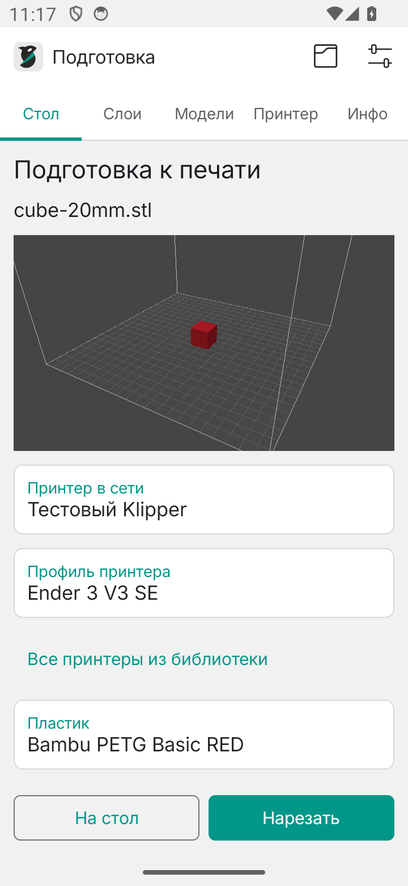
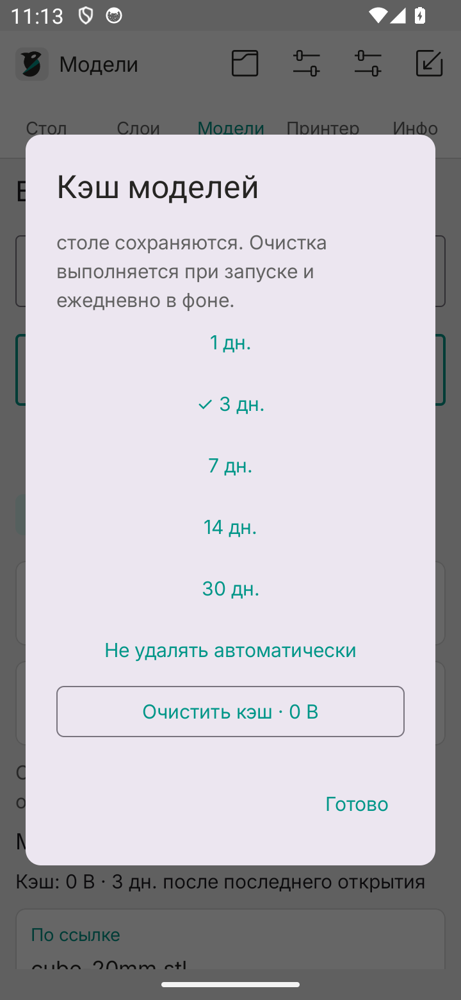

# Каталоги, поиск и кэш моделей

[← README](../README.md)

## Поиск по запросу и тегам

1. Откройте вкладку **«Модели»**.
2. Введите запрос, например `phone holder`, и при необходимости теги через запятую: `phone, stand`.
3. Нажмите карточку Thingiverse, Printables, Cults3D или MakerWorld. Откроется поиск выбранной площадки внутри приложения.
4. Один тег без запроса открывает страницу тега на Thingiverse, Printables и Cults3D. MakerWorld использует поиск по слову. При сочетании запроса и нескольких тегов они передаются сайту как слова поиска; дополнительные фильтры доступны на самой площадке.

В разделе **«Мои модели»** запрос ищется в названии, имени файла, источнике и тегах. Поле тегов требует совпадения всех указанных тегов целиком. Теги из страницы модели сохраняются, когда сайт предоставляет их в ссылках; кнопка **«Теги»** в карточке позволяет добавить или изменить их вручную. Быстрые фильтры показывают теги сохранённых карточек.

## Поиск по ссылке

Вставьте адрес модели прямо в поле поиска и нажмите **«Открыть ссылку»**. Поддерживаются страницы четырёх площадок, прямые HTTPS-ссылки на STL/ZIP/3MF и ссылки `orcaslicer://`. Ссылкой также можно поделиться в приложение через системное меню Android.

Пример страницы:

```text
https://www.printables.com/model/3161-3d-benchy
```

Пример ссылки на файл:

```text
https://raw.githubusercontent.com/redfaced97/OrcaSlicer-Android/main/samples/cube-20mm.stl
```

Приложение регистрирует схему `orcaslicer://`. Форматы:

```text
orcaslicer://open?file=https%3A%2F%2Fexample.com%2Fcube.stl
orcaslicer://open?url=https%3A%2F%2Fwww.printables.com%2Fmodel%2F3161
```

`file` — прямая HTTPS-загрузка; `url` — страница площадки. Необязательные `name` и `source` задают имя файла и страницу источника. Значения параметров кодируются как URL query. Ссылка открывает геометрию для подготовки, команды управления принтером в ней не выполняются. Кнопки «Открыть в PrusaSlicer / Bambu Studio» внутри встроенного браузера также распознаются, если передают HTTPS-адрес файла.

## Загрузка и карточки

На странице модели выберите STL, ZIP или 3MF. Обычная HTTPS-загрузка перехватывается приложением и сохраняется в кэш. Карточка содержит название, источник, доступное изображение, теги и кнопки **«На стол»**, **«К печати»**. Можно сохранить карточку до скачивания кнопкой **«В мои модели»**.

- **На стол** — открыть геометрию для перемещения, поворота и масштаба.
- **К печати** — открыть предпросмотр, выбор подключённого принтера и профилей принтера/пластика/процесса, быстрые настройки высоты слоя, заполнения и стенок.
- В ZIP с несколькими моделями сначала выберите нужную деталь. Соседние инструкции, изображения и G-code не импортируются как модель.
- 3MF импортируется как геометрия с единицами, компонентами и трансформациями. Все объекты объединяются; параметры автора, покраска, AMS и расположение по отдельным столам не переносятся. Используются ваши настройки печати.
- Файл ограничен 96 МБ. Для 3MF дополнительно ограничены распакованный XML, число компонентов, глубина ссылок и количество треугольников.

Вход в аккаунт, покупка и разрешение на скачивание остаются на стороне площадки. Если сайт не работает в WebView, требует внешний вход или создаёт внутреннюю `blob:`-загрузку, нажмите **«В браузере»**, скачайте файл обычным способом, затем откройте его кнопкой импорта в заголовке «Моделей» либо через «Добавить» на столе. Приложение не предоставляет единого серверного API этих площадок.

<p align="center">
  
  
</p>

## Кэш

Вкладка **«Модели»** → значок настроек в заголовке → **«Кэш моделей»**.

По умолчанию файлы хранятся **7 дней после последнего открытия**. Можно выбрать 1, 3, 7, 14, 30 дней или отключить автоматическое удаление. Очистка запускается при старте приложения, открытии библиотеки и ежедневно через Android JobScheduler; фоновый запуск может быть отложен системой.

**«Очистить кэш»** удаляет скачанные файлы сразу. Карточки, теги и ссылки остаются; текущая модель на столе хранится отдельно и продолжает открываться. Для удалённого файла карточка снова предлагает скачивание или исходный локальный документ. Размер занятого кэша показан в библиотеке и настройках. Кнопка «Удалить» у карточки убирает и карточку, и её файл.
